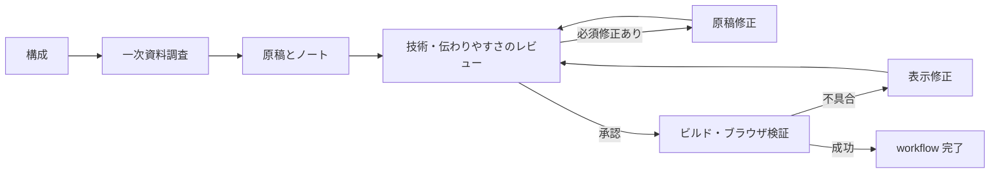

# 勉強会スライドの制作

`slide-production` は、複数の資料リポジトリで使う TAKT ワークフローです。chezmoi で `~/.takt/` に配置し、作業先の既存構成から原稿形式・保存先・ビルド・表示方法を確認します。TAKT 0.73.0 で定義を検証しています。

## 制作の流れ



入力・根拠・必須の検証環境が不足すれば理由を報告して停止します。ループを含めて最大32工程です。レビューは技術的な正確さと伝わりやすさの2観点を並行して行います。表示修正後も内容レビューと検証をやり直します。

## 準備

1. [依頼の雛形](../templates/slide-order.md)をコピーし、必須欄を埋める。テーマ、聴衆と前提知識、発表時間、到達目標、slug が必要です。slug は英小文字・数字・ハイフン（例: `nix-intro`）にし、既存原稿と重複させません。
2. 参考資料と、自分の経験として話したい内容を揃える。発表者名や所属、発表日を省略した場合は創作しません。資料を参照できない環境では、本文や必要部分を入力資料として渡します。
3. 作業先の最新ベースブランチから独立した作業ブランチ・worktree を利用する。対象資料リポジトリのルートで TAKT を起動します。定義は `~/.takt/` から参照されるので、各リポジトリへのコピーは不要です。プロジェクトに同名の `.takt/workflows/slide-production.yaml` があればそちらが優先されるため、古い定義との重複を確認してください。
4. 作業先の README・ビルド設定で要求されるツール、およびブラウザを操作できるエージェント環境を用意する。プロバイダー・モデル・権限は利用中の TAKT 設定を引き継ぎます。Web 調査の可否もその環境に依存します。

## 実行

chezmoi の適用後、実際の資料リポジトリのルートで起動します。dotfiles 自体に原稿を作成しないでください。

```sh
# エージェントを起動せずに定義を検査
takt workflow doctor slide-production

# 対話で記入済みの依頼を渡し、内容を確認して /go
takt --workflow slide-production --auto-pr --draft
```

`--auto-pr --draft` は workflow 成功後のランナーに commit・push・Draft PR 作成を依頼します。GitHub の認証と push 権限を事前に確認してください。workflow の各担当者は commit・push・PR 作成を行いません。自動マージや公開も行いません。

キューを使う場合は、登録時の workflow を `slide-production`、base branch を作業先の最新ベースブランチにし、worktree と Draft PR・push の設定を確認します。添付は task directory の `attachments/` 配下に置き、登録後に保存された指示・添付・開始ブランチを読み返します。必要情報の返答待ちになる依頼は先に埋めてから登録してください。

## 成果物

| 保存先 | 内容 |
| --- | --- |
| `brief.md` の `source_path` | 作業先の既存構成に合うスライド原稿 |
| `docs/slides/<slug>/brief.md` | 発表条件・到達目標・資料の参照元 |
| `docs/slides/<slug>/outline.md` | 構成、各スライドの要点と推定時間 |
| `docs/slides/<slug>/research.md` | 主張と一次資料・確認日・未確認事項 |
| `docs/slides/<slug>/speaker-notes.md` | 見出しに対応する話す内容・デモ手順 |
| `docs/slides/<slug>/revision-log.md` | 修正が発生した場合の指摘と対応 |
| `docs/slides/<slug>/verification.md` | ビルド・表示・操作の実行結果 |

`docs/` のメモも PR に含まれ、GitHub リポジトリから閲覧できます。原稿・ノート・添付から転記する内容に非公開情報を含めないでください。レビューの工程レポートは TAKT の実行レポートとして保存されます。

既存の原稿形式とページ区切りを使い、生成物を直接編集しません。調査メモや発表者ノートはビルド対象の原稿ディレクトリに置かないでください。

`brief.md` には `source_path` と必要な frontmatter・ページ区切り、生成先、依存インストール・ビルド・プレビューコマンド、対象URL、送り・戻りの操作方法も記録します。原稿パスの指定を省略した場合は既存構成から確定し、一意に判断できなければ停止します。

## 完了の判定

- 企画と出典に照らした2観点のレビューで、必須修正が残っていない。
- 作業先に定義された依存インストール・ビルドに成功している。ビルド不要の構成では根拠を記録して対象外とする。原稿追加だけのために新しい自動テストは作らない。
- ブラウザで対象スライド（一覧がある場合は一覧も）を開き、1280x720 と依頼された追加サイズで全スライドの可読性・画像・コードの表示、スライド送り・戻りを確認している。エンジンに縦方向の遷移がある場合はその操作も確認する。
- 検証したブラウザ、画面サイズ、URL、コマンドと終了コードを `verification.md` に記録している。

ビルドだけ成功した場合やブラウザを起動できない場合は、表示検証を省略して完了にはしません。環境不足は BLOCKED、不具合は修正工程へ進みます。共有テンプレート・アプリ・依存関係の変更が必要な場合は別の変更として扱います。

## 定義の確認・改修

```sh
takt workflow doctor slide-production
takt workflow inspect slide-production
```

ワークフローは [定義ファイル](../workflows/slide-production.yaml)、共通の約束は [policy](../facets/policies/slide-production.md)、プロジェクト構成の確認方法は [knowledge](../facets/knowledge/slide-project.md) にあります。各ファセットをワークフローからの相対パスで参照し、同じ配布セット内で完結します。

定義検査と inspect はエージェントを起動しません。TAKT 0.73.0 の `takt prompt slide-production` は判定プレビューで `reportContent is required for report-based judgment` により停止するため、この版では利用手順に含めていません。

定義検査だけでは実制作の品質や外部ツールの利用可否は確認できません。記入済みの依頼で実行して確認してください。

## lt-slide-warehouse で使う例

このプロジェクトでは原稿を `src/slides/<slug>.md`、ビルドを `npm ci`・`npm run build`、
プレビューを `/lt-slide-warehouse/slides/<slug>/` として使えます。実行時には README と設定を再確認します。
別のプロジェクトへこれらのパス・コマンドをそのまま適用しません。
